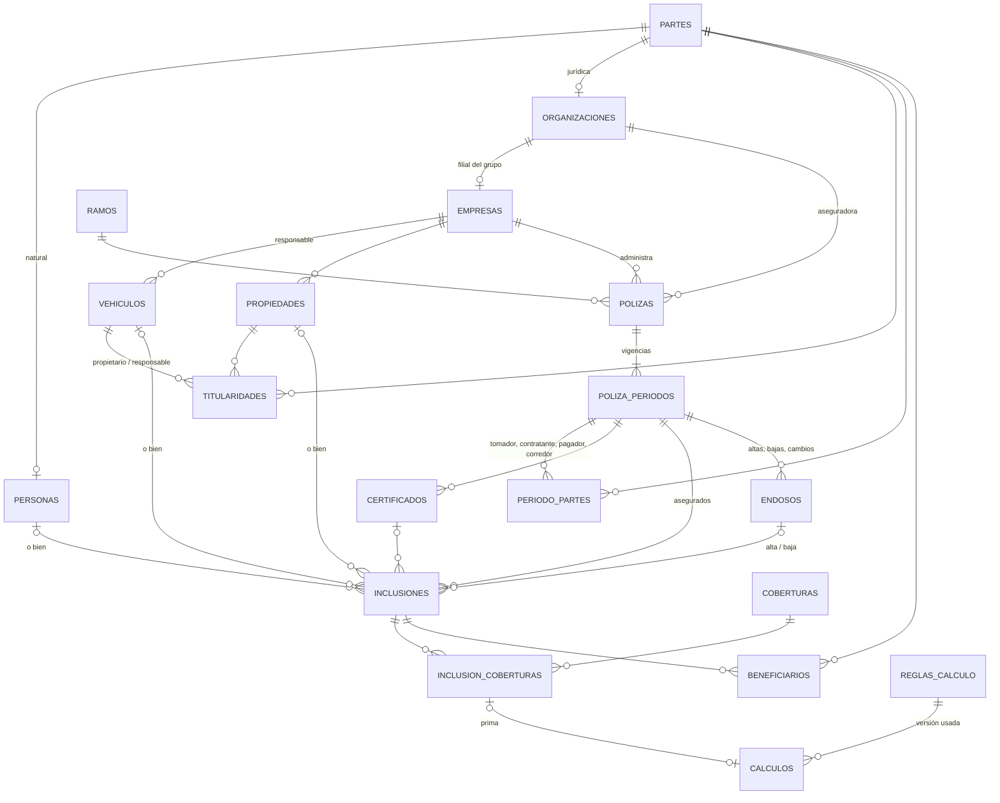
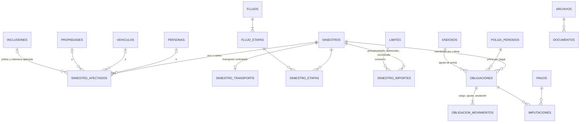

# Modelo de datos propuesto (Etapa 1)

Estado: **propuesta para validar**. Ningún nombre de tabla es definitivo hasta aprobar el diseño.
Esquema PostgreSQL: `cys` (nombre por confirmar). Tablas del sistema base con prefijo `app_`.

## 1. Decisiones de diseño

| # | Decisión | Por qué |
|---|---|---|
| D1 | **Partes** (`partes`) como supertipo de personas naturales (`personas`) y jurídicas (`organizaciones`). Tomador, contratante, pagador, beneficiario, propietario, aseguradora, corredor, taller y transportista apuntan a `partes`. | Un tomador o beneficiario puede ser persona o empresa. Una sola identidad por persona, con varios roles explícitos. |
| D2 | **Sujetos asegurados con llaves excluyentes**: las tablas que relacionan «algo asegurado» (`inclusiones`, `siniestro_afectados`, `documentos`) tienen una columna con llave foránea real por tipo (`id_persona`, `id_vehiculo`, `id_propiedad`, `id_bien`) y `CHECK (num_nonnulls(...) = 1)`. | Integridad referencial completa sin polimorfismo «tipo + id» ni disparadores. Agregar un tipo nuevo es una migración (columna + CHECK), que es raro y queda documentado. |
| D3 | **Póliza ≠ período**: `polizas` es la identidad del contrato; cada vigencia es un `poliza_periodos`. La renovación crea un período nuevo copiando el anterior. | Los valores históricos no se sobrescriben nunca. Permite comparar año contra año. |
| D4 | **Inclusiones con fechas efectivas**: quién o qué está asegurado en un período es una fila `inclusiones` con `desde`/`hasta`. Cambiar el asegurado cierra una inclusión y abre otra mediante un endoso. | Se conserva el histórico con fecha efectiva; nada se altera en silencio. |
| D5 | **Endosos** (`endosos`) como único camino para cambiar un período confirmado (altas, bajas, cambios de tomador/asegurado/beneficiario, valores, anulación). Estados: simulado → enviado → confirmado por la aseguradora → (anulado). | Separa simulación, importe de la aseguradora y obligación financiera. |
| D6 | **Reglas versionadas**: tasas, fórmulas, límites y prorrateos con ámbito (aseguradora, ramo, cobertura, póliza, período) y vigencia. Una regla aprobada no se edita: se crea versión nueva. | No hay un valor global; cada cálculo guarda la versión exacta usada. |
| D7 | **Dinero por movimientos**: obligaciones (por pagar / por cobrar) + pagos + imputaciones. Saldo = monto − Σ imputaciones vigentes. Anular = movimiento inverso autorizado. | Pagos parciales, un pago que cubre varias obligaciones, saldos verificables. «Autorizado» o «reconocido» nunca significa «pagado» o «cobrado». |
| D8 | **Empresa como frontera de datos** (`id_empresa` en todo registro de negocio, **también en personas**) y acceso por empresa en el usuario. Las llaves entre tablas de negocio son compuestas `(id_empresa, id)` para que nada apunte a otra empresa. | Confirmado por el cliente: las empresas se manejan por separado y no hay pólizas entre filiales. |
| D9 | **Archivos fuera de la base**: la BD guarda metadatos y una clave de almacenamiento generada por el servidor; el contenido va a carpeta compartida (intranet) o almacenamiento de objetos (demo). | Requisito explícito; mismo código con dos adaptadores. |
| D10 | **Bitácora append-only** estructurada (`app_bitacora`: operación, entidad, id, cambios `jsonb`, motivo) además del texto legible estilo `tgesth`. | Auditoría consultable por registro; nadie puede editarla (disparador que impide UPDATE/DELETE). |

> **Implementado en la Etapa 2 (migración 002):** D1 se simplificó a **una sola tabla `partes`**
> (naturales y jurídicas) con restricciones `CHECK` por tipo, en vez de tres tablas: misma
> integridad (una sola llave foránea para todos los roles), menos uniones. Todas las tablas llevan
> `empresa` y llaves compuestas `(empresa, id)`. **Sin relaciones persona–empresa** (socios): retiradas en
> la migración 003 por pedido del cliente; las organizaciones (aseguradoras, talleres…) son
> partes jurídicas con `funciones`. Catálogos simples en `catalogo_valores`; marcas y modelos aparte.

> **Implementado en la Etapa 3 (migración 004):** pólizas, períodos, partes del período, tarifas del
> período (tasas y primas fijas por cobertura y clase, en vez de `parametros_regla`), inclusiones con
> coberturas y beneficiarios, endosos con su detalle (`endoso_lineas`), reglas de cálculo versionadas,
> cálculos guardados y el núcleo financiero (obligaciones, movimientos, pagos, imputaciones y la vista
> de saldos). Cambios respecto a la propuesta: el certificado es un texto de la inclusión (sin tabla
> `certificados`); el ajuste de un cálculo se guarda en la misma cobertura (`prima_calculada`,
> `motivo_ajuste`, `ajustado_por`) más la bitácora, sin tabla `calculo_ajustes`; los estados del
> período son `borrador`/`confirmado`/`anulado` y «vigente / por vencer / vencido» se calcula con la
> fecha; `limites` queda para la Etapa 4 (riesgos diversos). Detalle en `docs/modulos/polizas.md`.

## 2. Diagrama general

## 3. Entidades

Columnas comunes a toda tabla de negocio (no se repiten abajo): `id bigint identity`,
`creado_en timestamptz`, `creado_por → app_usuarios`, `actualizado_en`, `actualizado_por`.

### 3.1 Sistema base (reutilizado de Legal, adaptado)

| Tabla | Contenido | Cambio respecto de Legal |
|---|---|---|
| `app_usuarios` | usuario, nombre, hash bcrypt, bloqueo, intentos, clave temporal | Igual |
| `app_roles`, `app_permisos`, `app_rol_permisos`, `app_usuario_roles` | roles globales (administrador, estándar, desarrollador) | Roles iniciales: **administrador** y **estándar** |
| `app_usuario_empresas` | (usuario, empresa, rol, `vigente_hasta`) | Reemplaza `app_usuario_departamentos`: el «área» es la empresa |
| `app_usuario_permisos` | permisos excepcionales por empresa (p. ej. `personas.datos_sensibles`) | Igual, por empresa |
| `app_ajustes` | parámetros (almacenamiento, días de aviso, tamaños) | Igual |
| `app_bitacora` | fecha, usuario, empresa, operación, entidad, id_registro, descripción, `cambios jsonb`, motivo | Se agregan columnas estructuradas y bloqueo de UPDATE/DELETE |
| `app_migraciones` | control de migraciones | Igual |

### 3.2 Partes, personas y empresas

| Tabla | Columnas clave | Restricciones |
|---|---|---|
| `partes` | `tipo` (`natural`/`juridica`), `estado` | `UNIQUE (id, tipo)` para llaves compuestas de subtipo |
| `personas` | `id_parte` PK, `tipo_parte='natural'`, `tipo_identificacion`, `numero_identificacion`, `identificacion_normalizada` (generada), `nombres`, `apellidos`, `fecha_nacimiento` (opcional), `telefono`, `correo`, `direccion`, `id_foto → archivos`, `estado` (`activa`/`inactiva`/`fusionada`), `fusionada_en → personas`, `observaciones` | FK `(id_parte, tipo_parte) → partes(id, tipo)`; único parcial `(tipo_identificacion, identificacion_normalizada) WHERE estado <> 'fusionada'`; índice `pg_trgm` sobre nombre para avisar posibles duplicados |
| `organizaciones` | `id_parte` PK, `tipo_parte='juridica'`, `identificacion_fiscal`, `razon_social`, `nombre_comercial` | mismo patrón; único parcial por identificación fiscal |
| `organizacion_funciones` | (organización, función: `aseguradora`, `corredor`, `taller`, `transportista`, `proveedor`) | PK compuesta; una organización puede tener varias |
| `empresas` | `id_parte` único → organizaciones, `id_empresa_matriz`, `activa` | Frontera de datos (tenant) |
| `fusiones_personas` | origen, destino, motivo, usuario, fecha, `foto_origen jsonb`, filas reapuntadas `jsonb` | Procedimiento de consolidación (§5.1) |

### 3.3 Activos

| Tabla | Columnas clave | Restricciones |
|---|---|---|
| `vehiculos` | `id_empresa` (responsable), `origen` (`propio`/`tercero`), `placa`, `placa_normalizada`, `id_modelo` (→ `modelos` → `marcas`), `anio`, `tm` (texto, **significado por confirmar**), `id_color`, `id_tipo_vehiculo`, `id_clasificacion_chuto`, `tiene_batea`, `fecha_adquisicion`, `fecha_baja`, `motivo_baja` (`venta`/`transferencia`/`retiro`), `estado` (`activo`/`vendido`/`retirado`), observaciones | Único parcial de placa entre vehículos no retirados (por confirmar); `CHECK` estado coherente con `fecha_baja` |
| `propiedades` | `id_empresa`, `nombre`, `id_tipo_inmueble`, `direccion`, `valor_declarado` + `moneda`, `estado`, `fecha_baja`, observaciones | |
| `bienes_otros` | `id_empresa`, `id_tipo_activo`, descripción, identificador, estado | Reservada para «otros asegurables»; se activa solo si el cliente lo pide |
| `titularidades` | llaves excluyentes `id_vehiculo`/`id_propiedad`/`id_bien`, `rol` (`propietario_legal`/`responsable_administrativo`), `id_parte`, `desde`, `hasta`, documento | `num_nonnulls = 1`; `EXCLUDE` sin solape por (activo, rol) |

La venta no borra el vehículo: cierra la titularidad, marca `estado='vendido'` y `fecha_baja`. La
renovación lo excluye si `fecha_baja < vigencia_desde` del nuevo período (regla configurable, §5.4).

### 3.4 Catálogos (Configuración)

Tablas propias cuando tienen estructura: `marcas`, `modelos` (→ marca), `ramos` (clase:
personas/patrimonial/vehículos/transporte/otros; tipos de sujeto admitidos), `coberturas` (→ ramo,
`id_cobertura_padre`, `incluida_en_padre`, `suma_en_total`), `tipos_siniestro` (→ ramo, flujo),
`flujos` + `flujo_etapas` + `flujo_etapa_documentos`, `monedas` (código ISO, decimales),
`organizaciones_admin` y `cecos` (por empresa, con vigencia), `tipos_documento`.

Listas simples en `catalogo_valores (lista, codigo, nombre, activo, orden)`: colores, tipos de
vehículo, clasificación de chuto, tipos de inmueble, tipos de relación empresarial, parentescos,
motivos de alta/baja. Nunca se borran valores en uso: se desactivan.

### 3.5 Pólizas

| Tabla | Columnas clave | Restricciones |
|---|---|---|
| `polizas` | `id_empresa`, `id_aseguradora → organizaciones`, `numero`, `id_ramo`, descripción, estado | Único `(id_aseguradora, numero)` (por confirmar) |
| `poliza_periodos` | `id_poliza`, `numero_periodo`, `vigencia_desde`, `vigencia_hasta`, `id_periodo_anterior`, `moneda`, `estado` (`borrador`/`en_renovacion`/`vigente`/`vencido`/`anulado`), `confirmado_por`, `confirmado_en` | `EXCLUDE` sin solape de vigencias de la misma póliza; un período `vigente` solo cambia por endoso (disparador) |
| `periodo_partes` | período, `rol` (`tomador`/`contratante`/`pagador`/`corredor`), `id_parte`, `desde`, `hasta`, `id_endoso` | `EXCLUDE` sin solape por (período, rol) salvo roles que admitan varios (por confirmar) |
| `certificados` | período, `numero`, descripción, `desde`, `hasta` | Único (período, número) |
| `inclusiones` | período, `id_certificado` (opcional), llaves excluyentes `id_persona`/`id_vehiculo`/`id_propiedad`/`id_bien`, `id_titular` (→ inclusiones, para dependientes), `desde`, `hasta`, `id_endoso_alta`, `id_endoso_baja`, `id_empresa_imputacion`, `id_ceco`, `id_organizacion_admin`, `valor_bien`, `valor_aditamentos`, `suma_asegurada` | `num_nonnulls = 1`; `EXCLUDE` sin solape del mismo sujeto en el mismo período; `desde/hasta` dentro de la vigencia |
| `inclusion_coberturas` | inclusión, cobertura, `suma_asegurada`, `limite`, `deducible`, `tasa`, `unidad_tasa`, `prima_anual`, `prima_periodo`, `origen` (`calculada`/`manual`/`aseguradora`), `id_calculo` | Único (inclusión, cobertura) |
| `beneficiarios` | inclusión, `id_parte`, `id_parentesco`, `porcentaje`, `desde`, `hasta`, `id_endoso` | Σ porcentajes vigentes ≤ 100 (validación en servidor, regla por confirmar) |
| `endosos` | período, `tipo`, `fecha_efectiva`, `estado`, `numero_aseguradora`, `prima_estimada`, `prima_confirmada`, `id_calculo`, `retroactivo`, motivo | Confirmar exige importe de la aseguradora o regla completa |

Una persona con varias pólizas = varias `inclusiones` con su `id_persona`. Una póliza con varias
personas = un período con varias `inclusiones`. Un socio asegurado es simplemente una persona con su fila en `inclusiones`.

### 3.6 Motor de cálculo y límites

| Tabla | Contenido |
|---|---|
| `reglas_calculo` | `tipo` (`prima`/`suma_asegurada`/`prorrateo`), ámbito (`id_aseguradora`, `id_ramo`, `id_cobertura`, `id_poliza`, `id_periodo`, todos opcionales: gana el más específico), `vigente_desde/hasta`, `version`, `estado` (`borrador`/`aprobada`/`retirada`), `expresion` (lenguaje seguro, §5.3) o `metodo` + `parametros jsonb` (prorrateo), `variables` declaradas, `redondeo` (decimales y modo), aprobada por/en |
| `parametros_regla` | clave, valor `numeric`, `unidad` (`porcentaje`/`por_mil`/`monto`/`factor`), moneda, ámbito y vigencia (tasas año a año) |
| `calculos` | regla + versión, copia de la expresión, `entradas jsonb`, `faltantes jsonb`, resultado, moneda, `estado` (`simulacion`/`definitivo`), usuario, fecha, a qué se aplicó |
| `calculo_ajustes` | cálculo, importe original, importe final, motivo, usuario, fecha |
| `limites` | ámbito (período, cobertura o inclusión), `tipo` (`agregado_anual`/`por_bien`/`por_evento`), monto, moneda, vigencia, qué importe consume (por confirmar) |

### 3.7 Siniestros

| Tabla | Contenido |
|---|---|
| `siniestros` | `id_empresa`, `numero_expediente` (único por empresa), `numero_aseguradora`, `id_tipo_siniestro`, `id_flujo`, `fecha_evento`, `fecha_notificacion`, descripción, `agrupador`, `tipo_perdida` (`parcial`/`total`), `estado`, `id_responsable`, `moneda`, `confidencial` (personas) |
| `siniestro_afectados` | siniestro, llaves excluyentes (`id_persona`/`id_vehiculo`/`id_propiedad`/`id_bien`) o ninguna si es transporte de tercero, `id_inclusion`, `id_cobertura`, `id_certificado`, daños |
| `siniestro_transporte` | 1:1 con siniestro: `id_transportista → organizaciones`, `placa_texto`, `id_vehiculo` (si es propio), mercancía, pérdida de mercancía |
| `siniestro_etapas` | siniestro, etapa del flujo, fecha inicio/fin, responsable, observaciones |
| `siniestro_actuaciones` | historial libre de actuaciones |
| `siniestro_importes` | `tipo` (`presupuestado`/`autorizado`/`reconocido`), monto, moneda, fecha, referencia, afectado, `revierte_a`; el valor actual es el último vigente de cada tipo, el resto queda como historial |

«Monto cobrado» no es una columna: es la suma de imputaciones de pagos recibidos a la obligación
por cobrar del siniestro. Cerrar la reparación no cierra la cuenta por cobrar.

### 3.8 Finanzas

| Tabla | Contenido | Regla |
|---|---|---|
| `obligaciones` | `id_empresa`, `naturaleza` (`por_pagar`/`por_cobrar`), `concepto` (`prima`/`ajuste_prima`/`reembolso_siniestro`/`otro`), `id_contraparte → partes`, origen (`id_periodo`/`id_endoso`/`id_siniestro`), moneda, emisión, vencimiento, `id_ceco`, `id_organizacion_admin` | Sin borrado |
| `obligacion_movimientos` | `tipo` (`cargo`/`aumento`/`disminucion`/`anulacion`), monto > 0, fecha, motivo, autorizado por, documento | Monto de la obligación = Σ cargos + aumentos − disminuciones − anulaciones |
| `pagos` | `sentido` (`egreso`/`ingreso`), fecha, monto, moneda, referencia, contraparte, documento, `anulado_por` | Sin borrado; la anulación es otro registro |
| `imputaciones` | pago, obligación, monto, fecha, `revierte_a` | Misma moneda que pago y obligación; Σ imputaciones ≤ pago y ≤ obligación (disparador) |

Vista `vw_saldos_obligaciones`: `saldo = monto_obligacion − Σ imputaciones vigentes`, por moneda.

### 3.9 Documentos y archivos

| Tabla | Contenido |
|---|---|
| `archivos` | `almacen` (`carpeta`/`nube`), `clave` (generada por el servidor, nunca del navegador), nombre original, tipo MIME **detectado por contenido**, tamaño, `sha256`, `es_imagen`, subido por/en, estado |
| `documentos` | archivo, `id_tipo_documento`, descripción, fecha, `id_empresa`, `confidencial`, llaves excluyentes a la entidad: persona, vehículo, propiedad, bien, relación empresarial, póliza, período, endoso, siniestro, etapa de siniestro, obligación, pago (`num_nonnulls = 1`) |

## 4. Índices principales

- Todas las llaves foráneas indexadas.
- Búsqueda: `personas(identificacion_normalizada)`, `gin (nombres || apellidos gin_trgm_ops)`,
  `vehiculos(placa_normalizada)`, `polizas(numero)`, `siniestros(numero_expediente)`.
- Vencimientos: `poliza_periodos(vigencia_hasta) WHERE estado = 'vigente'`.
- Reportes: `inclusiones(id_periodo, id_ceco)`, `obligaciones(id_empresa, naturaleza, vencimiento)`,
  `siniestros(id_empresa, estado, fecha_evento)`.
- Extensiones: `btree_gist` (exclusiones de solape) y `pg_trgm` (duplicados). Ambas vienen con
  PostgreSQL estándar y están en Neon; confirmar en el servidor del cliente (pregunta 16).

## 5. Procedimientos con historial

### 5.1 Consolidar personas duplicadas
1. Al crear: búsqueda por identificación exacta (bloquea) y por nombre parecido (avisa).
2. Si aparece un duplicado: un administrador compara ambas fichas y elige la que queda.
3. En una transacción: se reapuntan las filas que referencian a la ficha origen (relaciones,
   inclusiones, beneficiarios, titularidades, documentos, siniestros), se guarda cada fila movida en
   `fusiones_personas`, la origen queda `estado='fusionada'` con `fusionada_en`. Nada se borra; la
   fusión se puede revertir desde el registro.

### 5.2 Cambio de asegurado, tomador o beneficiario
Endoso con fecha efectiva: cierra la fila vigente (`hasta = fecha − 1`) y abre otra (`desde = fecha`).
El período anterior y las filas cerradas no se modifican. Queda en bitácora como operación sensible.

### 5.3 Fórmulas configurables (sin `eval`)
Lenguaje mínimo propio: números, variables declaradas en la regla (`valor_bien`, `aditamentos`,
`tasa`, `dias`…), `+ − × ÷`, paréntesis, comparaciones, `min`, `max`, `si(cond, a, b)`, `redondear`.
Se analiza a un árbol y se evalúa con aritmética decimal (`decimal.js`, que ya trae Prisma). Si falta
una variable obligatoria, el resultado es «incompleto» con la lista de faltantes y solo puede guardarse
como simulación. No se carga ninguna fórmula de ejemplo como si fuera real.

### 5.4 Renovación anual
Asistente que crea el período nuevo en `en_renovacion`: copia partes, certificados, inclusiones y
coberturas elegibles (regla de elegibilidad configurable; por defecto excluye vehículos con
`fecha_baja` anterior al inicio y lo muestra como «excluido» con su motivo), recupera valores del año
anterior, recalcula o deja registrar primas, compara contra el período previo, muestra el detalle por
organización y CECO y se confirma con trazabilidad. Al confirmar se generan las obligaciones de prima.

### 5.5 Prorrateo
Métodos configurables por aseguradora y póliza: días exactos con base 365, 366, 360 o año real;
meses completos o fraccionados (criterio de redondeo de mes); tabla de corto plazo; o «solo importe de
la aseguradora». **Sin método por defecto**: si no está configurado, el simulador lo informa y no
calcula.

## 6. Separación entre empresas y datos personales

- Todo registro de negocio lleva `id_empresa`. La DAL arma el alcance del usuario
  (`app_usuario_empresas` vigentes) y toda consulta filtra por él; las acciones verifican que la
  empresa del registro esté en el alcance antes de leer o escribir.
- Personas: cada empresa tiene sus propias fichas (`id_empresa`, identificación única dentro de la
  empresa). Ninguna búsqueda revela datos de otra empresa (respuesta 21).
- Integridad: cada tabla de negocio tiene `UNIQUE (id_empresa, id)` y las llaves foráneas entre
  ellas son compuestas `(id_empresa, id_x)`, así la base misma impide relacionar registros de dos
  empresas.
- Campos sensibles (fecha de nacimiento, contacto, dirección, siniestros de personas con
  `confidencial`) exigen `personas.datos_sensibles`; sin él se muestran enmascarados. Cada consulta de
  la ficha completa queda en la bitácora.
- Segunda capa opcional: Row Level Security de PostgreSQL con `set_config('cys.empresas', …)` por
  transacción. Se evalúa en la Etapa 2 (riesgo R4 de `PLAN.md`).

## 7. Fórmulas de indicadores (propuestas, por confirmar)

| Indicador | Fórmula |
|---|---|
| Suma asegurada anual | Σ `inclusiones.suma_asegurada` vigentes al corte, por moneda |
| Prima de casco / RCV / total | Σ `inclusion_coberturas.prima_periodo` de la cobertura (o hijas), excluyendo las marcadas `incluida_en_padre` del total |
| Tasa promedio | **ponderada**: Σ prima ÷ Σ suma asegurada (se muestra la fórmula en pantalla); alternativa simple a confirmar |
| Variación interanual | (valor año N − valor año N−1) ÷ valor año N−1, solo misma moneda |
| Saldo por pagar / por cobrar | Σ monto obligación − Σ imputaciones vigentes |
| Tiempo en etapa | `fecha_fin − fecha_inicio` (o hoy si está abierta) |
| Expediente sin movimiento | días desde la última actuación, etapa o importe > umbral de Ajustes |

Los indicadores y los reportes leen las mismas vistas SQL (`vw_*`), así que siempre coinciden.
